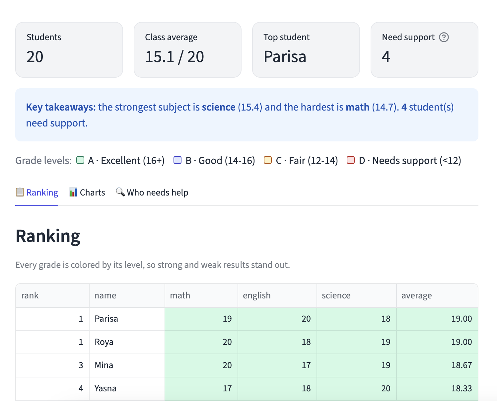
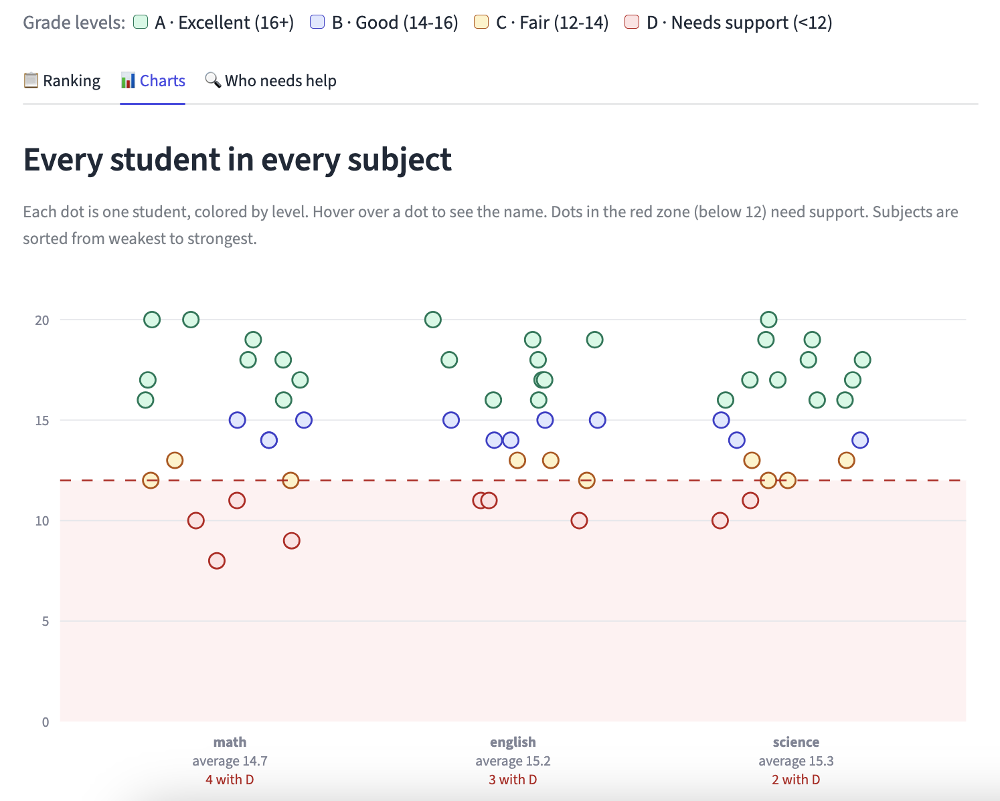

# Student Grade Dashboard

A web dashboard for teachers: upload a spreadsheet of class grades and instantly see who is doing well and who needs help. No setup, no formulas.

**[Try the live demo](https://grade-report-nyuxcngybqysj7pihhdda3.streamlit.app/)**




## What it does

- **Upload a CSV or Excel (.xlsx) file** with student names and one column per subject. The app finds the names and subjects by itself.
- **Works with any grading scale.** Full marks of 10, 20, 100 or a custom value; grade levels are calculated from it.
- **Colors every grade by level:** A (80%+), B (70-79%), C (60-69%) and D (below 60% of full marks).
- **Ranking table** with each student's average and rank, plus a CSV download of the results.
- **Dot chart of every student in every subject.** Hover a dot to see the name. Subjects are sorted from weakest to strongest, with the class average and the number of D grades under each one.
- **"Who needs help" list** showing students with a D and in which subjects.
- **Data check:** cells that cannot be used (empty, text like "ABS", or impossible grades) are listed with their spreadsheet row number, so you can fix the file.



## Try it with your own data

Your file needs one column with student names and one numeric column per subject:

| name | math | english | science |
|------|------|---------|---------|
| Ali  | 18   | 15      | 17      |
| Sara | 14   | 19      | 16      |

Extra columns such as `No.`, `Total` or `Rank` are ignored automatically. Use the **Settings** section to remove a subject or change the full marks if the app guessed wrong.

## Run it locally

Requires Python 3.11 or newer.

```
git clone https://github.com/thespiralmind/grade-report.git
cd grade-report
python3 -m venv venv
source venv/bin/activate
pip install -r requirements.txt
streamlit run app.py
```

The app opens in your browser. Uploaded files are processed in memory only and are not saved.

## Built with

- [Python](https://www.python.org/)
- [pandas](https://pandas.pydata.org/) for reading and cleaning the data
- [Streamlit](https://streamlit.io/) for the web interface
- [Plotly](https://plotly.com/python/) for the interactive chart

## What I learned

- Cleaning messy real-world spreadsheets with pandas: text in number columns, empty cells, impossible values, ties in rankings
- Designing for non-technical users: a clear first screen, plain-language labels, and a color guide that works across every view
- Building and testing a Streamlit app, and organizing the code into small functions

## Author

Made by [thespiralmind](https://github.com/thespiralmind)
